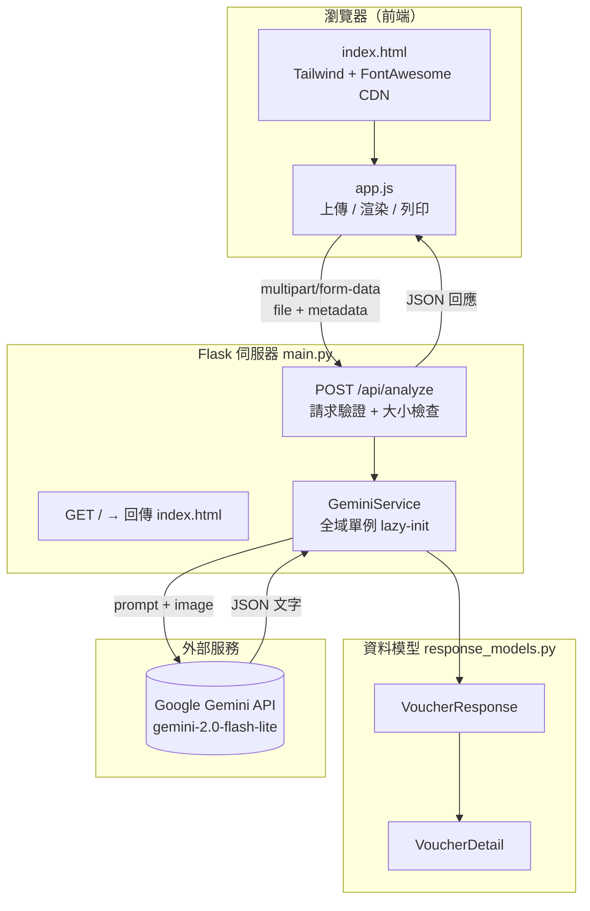
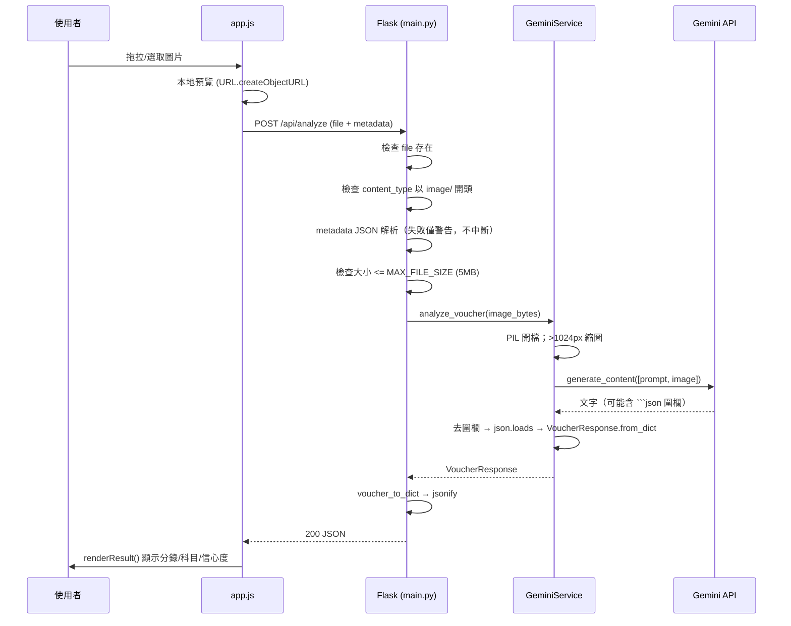

# 開發筆記：目前系統架構

> ⚠️ **已封存（2026-07-23）**：本文件描述的第一期 Flask POC 已移至 `archive/phase0_poc_flask/`（原 `src/`）。文中所有 `src/…` 路徑請對應到 `archive/phase0_poc_flask/…`。正式版改採 FastAPI + 混合 OCR/VLM 架構，位於 `app/`。本文件保留為歷史對照。

> 文件版本：v1（2026-07-23）
> 對應程式碼：`archive/phase0_poc_flask/`（原 `src/`，第一期／概念驗證 POC）
> 用途：紀錄現況架構、資料流、模組職責與已知限制，作為第二期開發的基準線。

---

## 1. 系統概觀

一個**單體 Flask Web 應用**，提供「上傳單張憑證圖片 → 呼叫 Google Gemini 辨識 → 回傳結構化會計分錄 → 前端顯示／列印」的流程。

- 定位：第一期報價單中「會計憑證自動化流程**概念驗證（POC）**」。
- 前端標題即為「會計憑證自動化概念驗證」。
- 目前為**無狀態（stateless）**：一次請求回一次結果，**無任何持久化**（無資料庫、無檔案落地）。

### 技術棧

| 層 | 技術 | 版本／來源 |
|---|---|---|
| Web 框架 | Flask | `>=3.0.0` |
| AI 辨識 | Google Gemini（`google-generativeai`） | `>=0.8.0`，模型 `gemini-2.0-flash-lite` |
| 影像處理 | Pillow | `>=10.0.0` |
| 前端 | 原生 HTML + JavaScript（無框架） | — |
| 前端樣式 | Tailwind CSS 2.2.19、Font Awesome 6.0.0 | **CDN 載入** |
| 資料模型 | Python `dataclasses` | 標準庫 |

---

## 2. 目錄結構

```
src/
├── main.py                     # Flask 進入點、路由、請求驗證
├── config.py                   # 全域設定常數
├── requirements.txt            # 依賴（flask / google-generativeai / Pillow）
├── __init__.py
├── models/
│   ├── __init__.py
│   └── response_models.py      # VoucherResponse / VoucherDetail 資料類別
├── services/
│   ├── __init__.py
│   └── gemini_service.py       # Gemini 呼叫 + 提示詞 + 回應解析
└── static/
    ├── index.html              # 單頁前端
    └── app.js                  # 前端邏輯（上傳/顯示/列印）
```

---

## 3. 架構分層



分層職責：

- **前端（static/）**：純瀏覽器端，負責檔案選取、預覽、送出、結果渲染、列印。
- **Web 層（main.py）**：路由、輸入驗證、錯誤轉換、序列化回應。
- **服務層（gemini_service.py）**：提示詞組裝、影像前處理、呼叫 Gemini、清理與解析回應。
- **模型層（response_models.py）**：定義資料契約，負責 `dict ↔ dataclass` 轉換與欄位正規化。

---

## 4. 請求資料流（`POST /api/analyze`）



---

## 5. 模組詳述

### 5.1 `main.py`（Web 層）

- 建立 Flask app：`static_folder="static"`、`static_url_path="/static"`。
- **自訂日誌**：`LocalTimeFormatter` 使用本機時間格式化 log。
- **服務單例**：全域 `_gemini_service`，透過 `get_gemini_service()` **延遲初始化**（第一次請求才建立）。
- 路由：
  - `GET /` → 回傳 `static/index.html`。
  - `POST /api/analyze` → 主流程。
- 請求驗證順序：
  1. `file` 是否存在且有檔名 → 否則 400「請上傳圖片檔案」。
  2. `content_type` 是否以 `image/` 開頭 → 否則 400「僅支援圖片檔案」。
  3. `metadata`（表單欄位）嘗試 `json.loads`，**失敗只記 warning 不中斷**。
  4. 讀取內容，`len > MAX_FILE_SIZE` → 400「檔案大小超過限制」。
- 呼叫服務並型別檢查（非 `VoucherResponse` → 500），例外統一轉 500「分析失敗: …」。
- `__main__`：啟動前檢查依賴與 API key，`app.run(debug=True, use_reloader=False)`。

### 5.2 `config.py`（設定）

| 常數 | 值 | 備註 |
|---|---|---|
| `PORT` | `5000` | |
| `HOST` | `"0.0.0.0"` | 對外綁定所有介面 |
| `GEMINI_API_KEY` | `""` | **硬編碼且為空**；未設定時服務初始化會 raise |
| `GEMINI_MODEL` | `"gemini-2.0-flash-lite"` | |
| `MAX_FILE_SIZE` | `5 * 1024 * 1024` | 5MB |
| `ALLOWED_EXTENSIONS` | `{.jpg,.jpeg,.png,.bmp,.tiff,.webp}` | ⚠️ **定義但未被引用**；實際驗證用 `content_type` 而非副檔名 |
| `LOG_LEVEL` | `"INFO"` | |

### 5.3 `services/gemini_service.py`（服務層）

- `get_accounting_prompt()`：回傳固定提示詞，要求 Gemini 以指定 JSON 格式回覆會計分錄。
- `GeminiService.__init__()`：無 key 即 `raise ValueError`；`genai.configure` + 建立 `GenerativeModel`。
- `analyze_voucher(image_bytes)`：
  1. `PIL.Image.open`。
  2. 若任一邊 > 1024px，`thumbnail((1024,1024))` 縮圖（LANCZOS）。
  3. `generate_content([prompt, image])`。
  4. 清理回應：去除開頭 ` ```json `／` ``` `、結尾 ` ``` ` 圍欄。
  5. `json.loads` → `VoucherResponse.from_dict`；解析失敗轉 `ValueError`。
- **測試阻礙**：影像前處理、網路呼叫、回應解析**綁在同一方法**；最有測試價值的「清理＋解析」段無法脫離網路單獨測（建議抽 `_parse_response(text)`）。

### 5.4 `models/response_models.py`（資料模型）

- `@dataclass VoucherDetail`：`description, amount, debit_account, debit_account_name, credit_account, credit_account_name`。
- `@dataclass VoucherResponse`：`voucher_id, date, summary, total_amount, details[], debit_total, credit_total, balance_check, confidence_level?, tax_amount?`。
- `from_dict()` 內含正規化邏輯：
  - `confidence` → `confidence_level` 別名相容。
  - 缺欄位給預設、字串化、巢狀 `details` 逐項轉換。
- `voucher_to_dict()`：`dataclasses.asdict` 序列化。
- **純資料層、零外部相依 → 可立即單元測試。**

### 5.5 `static/`（前端）

- `index.html`：左右雙欄版面（左：上傳＋額外資訊；右：結果／使用說明），含列印專用樣式。
- `app.js`（IIFE）：
  - 拖拉／點選上傳 → `analyzeFile()` → `fetch('/api/analyze')` → `renderResult()`。
  - `buildMetadata()`：把 `transactionType/department/projectCode` 組成 JSON。
  - 列印：`printMenuBtn` 切換選單、`printBtn` 呼叫 `window.print()`。
- ⚠️ **前端未接線項目**：
  - `<input multiple>` 存在，但只取 `files[0]`（單張）。
  - `thumbnailStrip` 容器存在，但**未產生縮圖**。
  - `downloadPdfBtn`（下載 PDF）按鈕存在，但**未綁定事件**。
  - `editable-field` 樣式存在（含 `.editing`），但**欄位編輯邏輯未實作**，全為唯讀。

---

## 6. API 規格

### `POST /api/analyze`

- **Content-Type**：`multipart/form-data`
- **參數**：
  - `file`（必填）：圖片檔，`content_type` 須以 `image/` 開頭，≤ 5MB。
  - `metadata`（選填）：JSON 字串，如 `{"transaction_type","department","project_code"}`；格式錯誤僅警告。
- **成功 200**：`VoucherResponse` 的 JSON：

```json
{
  "voucher_id": "string",
  "date": "YYYY-MM-DD",
  "summary": "string",
  "total_amount": 0,
  "details": [
    {
      "description": "string",
      "amount": 0,
      "debit_account": "string",
      "debit_account_name": "string",
      "credit_account": "string",
      "credit_account_name": "string"
    }
  ],
  "debit_total": 0,
  "credit_total": 0,
  "balance_check": true,
  "confidence_level": "high | medium | low",
  "tax_amount": 0
}
```

- **錯誤**：`400`（無檔案／非圖片／超過大小）、`500`（回傳格式不符／分析例外），皆為 `{"detail": "..."}`。

---

## 7. 設定與部署現況

- 啟動：`pip install -r requirements.txt` 後 `python main.py`，開 `http://127.0.0.1:5000`。
- 執行模式：`debug=True`（開發用），單一行程、單一 Gemini 單例。
- 無容器化、無 WSGI（gunicorn/uWSGI）、無反向代理、無 CI/CD。
- 機密管理：API key 直接寫在 `config.py`（目前為空）。

---

## 8. 已知限制與技術債

| 類別 | 項目 | 影響 |
|---|---|---|
| 持久化 | **完全無資料庫**，請求無狀態 | 無法做審核回饋、修正回寫、模型對齊、歷史查詢 |
| 認證 | 無登入、無角色 | 無法區分記帳士／會計師權限 |
| 檔案型別 | 只收 `image/*`，**不支援 PDF** | 與「PDF 掃描辨識」產品定位不符；第二期要求批次 PDF |
| 批次 | 僅單張 | 第二期要求批次上傳 |
| 資料模型 | 缺買受人/賣方名稱與統編、品名、數量、單價、備註 | 憑證原始欄位不完整，統編核對缺資料基礎 |
| 安全 | API key 硬編碼、`debug=True`、`HOST=0.0.0.0` | 不宜用於正式環境；金鑰應改環境變數 |
| 設定一致性 | `ALLOWED_EXTENSIONS` 定義但未使用 | 驗證邏輯與設定不一致，易誤解 |
| 前端 | `multiple`/`thumbnailStrip`/`downloadPdfBtn`/`editable-field` 皆未接線 | 有 UI 骨架但功能未完成 |
| 品質 | **無單元測試**、無測試目錄 | 重構與擴充風險高 |
| 可測性 | 服務層 I/O 與純邏輯混雜 | 解析邏輯難以單獨測試 |

---

## 9. 尚未實作（對照報價單／合約）

- **第一期概念驗證**尚缺：完整憑證欄位結構化、單月日記帳彙整、雙角色審核（記帳士→會計師）、模型對齊回寫、線上反饋紀錄。
- **第二期合約**尚缺（全新）：批次 PDF、企業名稱/統編核對、進口報單處理鎖定、客製科目編號編輯、兩套報表模板、營業稅媒體檔（TXT／TET_U）與 401、帳密登入/基本資安、地端備份模組。

---

## 附錄：關鍵檔案索引

| 檔案 | 職責 |
|---|---|
| `src/main.py` | 路由、請求驗證、服務單例、日誌 |
| `src/config.py` | 全域設定常數 |
| `src/services/gemini_service.py` | 提示詞、影像前處理、Gemini 呼叫、回應解析 |
| `src/models/response_models.py` | `VoucherResponse`/`VoucherDetail` 資料契約 |
| `src/static/index.html` | 單頁前端版面與列印樣式 |
| `src/static/app.js` | 前端上傳／渲染／列印邏輯 |
