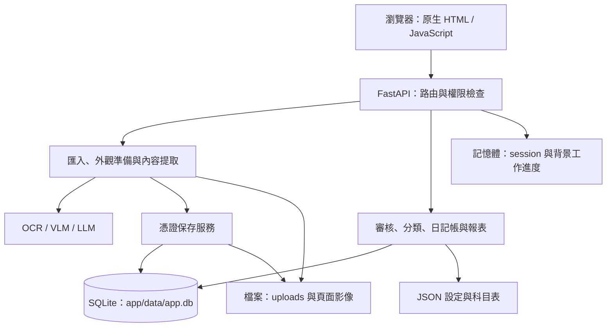
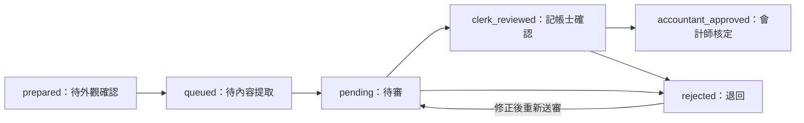

# 開發筆記：目前系統架構

> 文件版本：v2（2026-09-21）
> 對應程式碼：`app/`（FastAPI 正式版）
> 本文件依目前程式實作整理；第一期 Flask 概念驗證請見 [POC 歷史架構](architecture-phase0.md)，其程式位於 `archive/phase0_poc_flask/`。

## 1. 系統概觀

本系統為單體 FastAPI Web 應用，將 PDF／圖片轉為可供人工審核的會計憑證資料。前端使用原生 HTML／JavaScript；後端處理檔案匯入、OCR／VLM 辨識、會計科目分類、審核、日記帳與報表。

**目前有資料持久化**：使用 SQLite 儲存帳號及憑證紀錄，掃描影像與設定則另存於檔案系統。登入 session 與背景工作進度仍保存在程序記憶體中。

| 層 | 技術與用途 |
|---|---|
| Web | FastAPI + Uvicorn，API 與靜態前端由同一應用提供 |
| 資料契約 | Pydantic，定義憑證、分錄與設定結構 |
| 資料庫 | SQLite + SQLModel ORM，無需獨立資料庫伺服器 |
| PDF／影像 | pypdfium2 轉頁圖、Pillow 處理影像 |
| 文字與內容辨識 | 可選 PaddleOCR，搭配 VLM／LLM 結構化與後處理 |
| 模型介面 | LangChain；支援 Ollama、內網 H200 的 OpenAI 相容端點及雲端 provider |
| 背景工作 | Python 執行緒 + 前端輪詢，工作狀態放在記憶體 |

依賴清單見根目錄 `requirements.txt` 與 `requirements-ocr.txt`。

## 2. 目錄與模組職責

下列路徑相對於專案根目錄：

| 路徑 | 職責 |
|---|---|
| `app/main.py` | FastAPI 路由、登入權限檢查、上傳、背景工作與結果序列化 |
| `app/config.py` | 資料路徑、環境變數、模型預設值與上傳限制 |
| `app/db/models.py` | `UserAccount`、`VoucherRecord` 與審核狀態 |
| `app/db/session.py` | SQLite engine、session、建表與輕量欄位遷移 |
| `app/models/schemas.py` | 憑證與分錄等 Pydantic 資料契約 |
| `app/core/pipeline.py` | PDF 轉頁圖、外觀準備、內容提取與辨識結果清理 |
| `app/core/doc_router.py`、`app/core/doc_types.py` | 文件類型判定、各類型欄位與提示詞 |
| `app/core/model_factory.py`、`app/core/ocr_engine.py` | 模型 provider 與 OCR 引擎封裝 |
| `app/core/settings_store.py` | 辨識階段的模型設定讀寫 |
| `app/services/review.py` | 憑證落地、人工修改、審核、影像操作與對齊資料 |
| `app/services/auth.py` | 帳號驗證、密碼雜湊及記憶體 session |
| `app/services/classify.py`、`app/services/accounts.py` | 會計科目分類、範例檢索與科目表 |
| `app/services/taxid.py`、`app/services/importdecl.py` | 統編核對、公司登錄讀取與進口報單處理 |
| `app/services/journal.py`、`app/services/reports.py` | 日記帳彙整與報表 |
| `app/services/sysconfig.py`、`app/services/backup.py` | 系統組態與本機 ZIP 備份 |
| `app/services/database_view.py` | 管理員唯讀資料庫查詢，資料表清單、搜尋與分頁 |
| `app/static/database.html` | 管理員資料庫檢視頁，支援長文字與 JSON 展開 |
| `app/static/` | 瀏覽器操作介面 |
| `app/data/` | SQLite、設定、上傳影像、日誌及備份 |

## 3. 架構分層

分類範例檢索讀取 SQLite 中已核定的憑證，透過 Ollama embedding 與程式內餘弦相似度挑選範例；目前沒有獨立向量資料庫。

## 4. 資料庫與持久化

### 4.1 連線與初始化

`app/config.py` 將 `DB_FILE` 設為 `app/data/app.db`；`app/db/session.py` 使用 `sqlite:///{config.DB_FILE}` 建立 engine，並設定 `check_same_thread=False`。

載入 `app/main.py` 時會呼叫 `init_db()`：先以 `SQLModel.metadata.create_all()` 建立尚未存在的資料表，再執行 `_migrate()` 處理指定欄位。這是程式內的輕量遷移，並非具版本管理的完整 migration 系統。接著 `auth.ensure_seed_users()` 在帳號表為空時建立種子帳號。

### 4.2 資料表

| 資料表 | 主要內容 |
|---|---|
| `users` | 帳號、密碼雜湊與 salt、角色、顯示名稱、建立時間 |
| `voucher_records` | 來源檔名、公司、期別、審核狀態、信心度、AI 與目前憑證內容、審核備註／時間、模型資訊、影像路徑與附頁清單 |

`voucher_records.ai_json` 與 `current_json` 都是 JSON 文字欄位，包含結構化憑證與分錄。人工編輯只更新 `current_json`，可與 AI 輸出比較；重新辨識／內容提取會重新寫入兩者，因此 `ai_json` 並非永久不可變的歷史版本。審核備註與時間保存在同筆紀錄，目前沒有獨立的逐次操作稽核表。

### 4.3 資料存放位置

| 位置 | 保存內容 |
|---|---|
| `app/data/app.db` | 使用者與憑證紀錄 |
| `app/data/uploads/` | 上傳檔案與處理影像；`pages/` 保存供審核對照的頁圖 |
| `app/data/settings.json` | 各辨識階段模型選擇 |
| `app/data/system_config.json` | 系統組態，由 `sysconfig.py` 管理 |
| `app/data/accounts.json` | 公司別會計科目表 |
| `app/data/companies.json` | 公司登錄資料 |
| `app/data/entry_examples.json` | 分類用的種子分錄範例（若存在） |
| `app/data/logs/app.log` | 滾動日誌 |
| `app/data/backups/` | 備份 ZIP 檔 |
| 程序記憶體 | 登入 token、匯入工作 `_job`、內容提取工作 `_ejob` |

影像本體不存入 SQLite；資料庫只記錄相對於 `uploads/` 的影像路徑。程序重啟後已提交的憑證與檔案仍存在，但登入 token 和工作進度不會保留。

## 5. 匯入、辨識與審核資料流

1. 使用者登入後上傳 PDF／圖片，或從設定的掃描來源目錄匯入。上傳檔案會檢查副檔名與 5MB 大小限制，再寫入 `uploads/`。
2. `pipeline.prepare_pages()` 進行頁面準備、類型判定與轉正；`review.save_voucher()` 將每筆憑證存入 SQLite，狀態為 `prepared`，並保存對照影像。
3. 使用者確認外觀與文件類型後，紀錄轉為 `queued`，等待內容提取。
4. 單筆或批次內容提取依文件類型使用 OCR／VLM，完成結構化及欄位清理，再將結果存回紀錄；`prepared`／`queued` 紀錄轉為 `pending`。
5. 使用者修改欄位、執行會計科目分類，再由記帳士確認與會計師核定。修改、分錄、備註及狀態存回資料庫。
6. 日記帳與報表服務讀取保存的憑證資料；對齊介面提供已核定資料中 AI 與人工版本有差異的配對。

以上圖示表達預期操作流程；服務中的狀態更新並非完整的狀態機轉移驗證。

## 6. 主要 API

除登入、登出、目前使用者與健康檢查等公開入口外，`/api/` 路由由 middleware 檢查登入。`/api/me` 本身仍會驗證 session。核定／退回限會計師或管理員；科目表寫入、備份、系統組態與開發者回饋等另有管理員限制，詳細條件見 `auth_guard()` 與個別路由。

| 方法與路徑 | 用途 |
|---|---|
| `POST /api/login`、`POST /api/logout`、`GET /api/me` | 登入、登出與目前使用者 |
| `POST /api/analyze` | 單檔匯入與外觀準備；回傳 `id`、`ids`、`count`、`prepared` 及首筆憑證 |
| `POST /api/batch`、`GET /api/job` | 多檔背景匯入與進度輪詢 |
| `GET /api/scan-source/list`、`POST /api/scan-source/import` | 掃描來源清單與匯入 |
| `GET /api/vouchers`、`GET /api/vouchers/{rec_id}` | 依狀態／公司／期別查詢與單筆內容 |
| `PUT /api/vouchers/{rec_id}` | 保存人工修正內容 |
| `POST /api/vouchers/{rec_id}/confirm` | 外觀確認，加入待提取清單 |
| `POST /api/vouchers/{rec_id}/recognize` | 單筆內容提取 |
| `POST /api/extract-batch`、`GET /api/extract-job` | 批次內容提取與進度輪詢 |
| `POST /api/vouchers/{rec_id}/classify` | 產生會計科目分錄 |
| `POST /api/vouchers/{rec_id}/clerk-review`、`/approve`、`/reject`、`/resubmit` | 記帳士確認、核定、退回、重新送審；後三者共用前述憑證路徑前綴 |
| `GET /api/journal`、`GET /api/report` | 日記帳與報表 |
| `GET /api/alignment`、`GET /api/feedback` | 對齊配對與開發者回饋 |
| `GET /api/config`、`POST /api/config` | 模型設定 |
| `GET /api/sysconfig`、`POST /api/sysconfig` | 系統組態 |
| `POST /api/backup`、`GET /api/backups`、`GET /api/backup/download/{name}` | 建立、列出、下載備份 |

`POST /api/analyze` 的表單為 `file` 與選填 `company`；目前先準備外觀並落地，不再是舊 POC 的「單次呼叫 Gemini 後直接回傳完整分錄」。完整路由與參數以 `app/main.py` 為準。

## 7. 設定與啟動

管理員可從主頁頂部「資料庫檢視」開啟 `/database.html`，依序選擇資料庫與資料表。後端 `GET /api/database/tables` 列出固定資料庫路徑中的非 SQLite 內部資料表、筆數、中文名稱、用途及可用篩選條件；`GET /api/database/rows` 接受 `database`、`table`、`q`、`page`、`page_size`，另可使用 `date_from`、`date_to`、`status` 篩選，欄位資訊含中文名稱。日期篩選僅用於有指定日期來源的表；憑證紀錄依 `current_json.date`，驗證資料庫的日期依台灣時間計算。搜尋、日期和狀態條件同時用於筆數與分頁查詢（每頁最多 100 筆）。
資料來源包含 `app/data/app.db` 及已存在的 `app/data/validation/validation.db`。兩個 API 均在 router dependency 檢查管理員權限，以 SQLite `mode=ro` 與 `query_only` 讀取；查詢限定已存在的資料表並綁定搜尋參數，不提供任意 SQL 執行。`password_hash`、`salt` 在查詢結果中遮蔽，且排除於搜尋條件之外。

- `.env` 由 `python-dotenv` 載入；範本見根目錄 `.env.example`。模型端點與雲端金鑰依使用的 provider 設定。
- 預設服務位置為 `127.0.0.1:8090`；以 `start_webui.bat` 啟動 Uvicorn，或在已安裝依賴的環境執行 `python -m uvicorn app.main:app --host 127.0.0.1 --port 8090`。
- PaddleOCR 為選配，另見 `requirements-ocr.txt`；環境安裝與純 VLM 模式請參考根目錄 README。
- 帳號密碼使用 PBKDF2-HMAC-SHA256 與 salt 保存；登入後以 HttpOnly、SameSite=Lax cookie 傳遞 session token，token 對應資料保存在記憶體。部署時應更新種子帳號密碼。

## 8. 備份範圍與目前限制

| 項目 | 目前行為與影響 |
|---|---|
| 備份範圍 | `backup.py` 僅將存在的 `app.db`、`settings.json`、`accounts.json`、`companies.json` 打包；不含 `uploads/`、`system_config.json`、種子分錄與日誌，不能視為完整資料目錄備份 |
| 備份方式 | 直接將資料庫檔案加入 ZIP，未使用 SQLite 線上備份 API；目前 API 提供建立／列出／下載，沒有還原端點 |
| 工作與 session | 保存在單一程序記憶體，重啟後消失；沒有持久化工作佇列或跨程序共享狀態，不宜直接用多 worker 假設狀態一致 |
| 資料遷移 | 僅處理程式列出的新增／修正欄位，未提供完整版本化遷移流程 |
| 修改歷程 | 保留 AI 與目前值及審核欄位，但不保存每次修改的完整版本；重新辨識會覆寫 AI 與目前值 |
| 模型對齊 | 已有修正配對與已核定範例檢索，不代表已建置自動微調訓練流程 |

本文件描述程式現況，不作為合約項目全部完成或驗收通過的判定。
