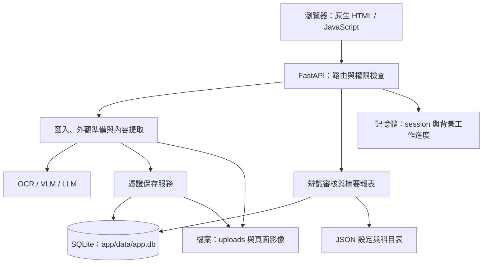
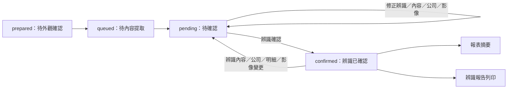
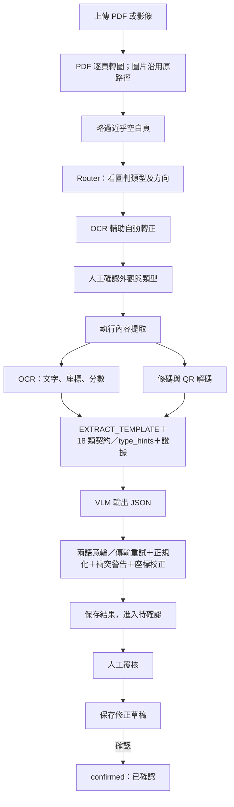

# 開發筆記：目前系統架構

> 文件版本：v4（2026-10-06）
> 對應程式碼：`app/`（FastAPI 正式版）
> 本文件依目前程式實作整理；第一期 Flask 概念驗證請見 [POC 歷史架構](architecture-phase0.md)，其程式位於 `archive/phase0_poc_flask/`。
>
> 現行主設定只供 OCR 與 structure（單據分類／欄位擷取）；AI 會計分錄建議、草稿、確認、日記帳及會計傳票格式已退役。紙面 `journal_voucher` 的借貸明細、合計與來源證據仍屬辨識內容；辨識報告列印、明細科目記憶規則及摘要彙總表 API 保留。舊 `index.html` 已移除，正式 HTML 使用者手冊為 `docs/manual/使用者手冊.html`。

## 1. 系統概觀

本系統為單體 FastAPI Web 應用，將 PDF／圖片轉為可供人工審核的憑證資料。前端使用原生 HTML／JavaScript；後端處理檔案匯入、OCR／VLM 辨識、人工核對、辨識報告及摘要彙總。AI 會計分錄建議、草稿與確認、日記帳和會計傳票格式已退役。

目前辨識主流程為「單據類型判定 → 人工確認外觀 → OCR＋VLM 欄位擷取 → 規則校正 → 人工覆核」。VLM 負責單據類型及內容理解；OCR 提供文字與位置證據。紙面傳票的 entries 和合計是辨識欄位，不會生成會計建議或入帳資料。

**目前有資料持久化**：使用 SQLite 儲存帳號及憑證紀錄，掃描影像與設定則另存於檔案系統。登入 session 與背景工作進度仍保存在程序記憶體中。

| 層 | 技術與用途 |
|---|---|
| Web | FastAPI + Uvicorn，API 與靜態前端由同一應用提供 |
| 資料契約 | Pydantic，定義憑證、明細、紙面傳票辨識資料與設定結構 |
| 資料庫 | SQLite + SQLModel ORM，無需獨立資料庫伺服器 |
| PDF／影像 | pypdfium2 轉頁圖、Pillow 處理影像 |
| 文字與內容辨識 | 可選 PaddleOCR，搭配 VLM／LLM 結構化與後處理 |
| 模型介面 | LangChain；支援 Ollama、內網 H200 的 OpenAI 相容端點及雲端 provider |
| 背景工作 | Python 執行緒 + 前端輪詢，工作狀態放在記憶體 |

依賴清單見根目錄 `requirements.txt` 與 `requirements-ocr.txt`。

## 2. 目錄與模組職責

下列路徑相對於專案根目錄：

| 路徑 | 職責 |
|---|---|
| `app/main.py` | FastAPI 路由、登入權限檢查、上傳、背景工作與結果序列化 |
| `app/config.py` | 資料路徑、環境變數、模型預設值與上傳限制 |
| `app/db/models.py` | `UserAccount`、`VoucherRecord` 與審核狀態 |
| `app/db/session.py` | SQLite engine、session、建表與輕量欄位遷移 |
| `app/models/schemas.py` | 憑證、明細與紙面傳票辨識資料等 Pydantic 契約 |
| `app/core/pipeline.py` | PDF 轉頁圖、外觀準備、內容提取與辨識結果清理 |
| `app/core/prompts.py`、`app/core/doc_types.py` | 辨識提示詞建構器與 18 類欄位契約／`type_hints` |
| `app/core/doc_router.py` | Router JSON 回應解析及類型鍵處理 |
| `app/core/model_invocation.py`、`app/core/normalization.py` | 模型兩語意輪呼叫策略與輸出正規化 |
| `app/core/model_factory.py`、`app/core/ocr_engine.py` | 模型 provider 與 OCR 引擎封裝 |
| `app/core/barcode.py` | 條碼／QR 解碼及電子發票欄位解析 |
| `app/core/activity.py`、`app/core/invocation_trace.py` | 辨識階段狀態、計時與執行上下文的模型／OCR trace |
| `app/core/settings_store.py` | 辨識階段的模型設定讀寫 |
| `app/validation.py` | 獨立資料集、驗證批次、模型組合、排程及辨識證據保存 |
| `app/services/review.py` | 憑證落地、人工修改、審核、影像操作與對齊資料 |
| `app/services/auth.py` | 帳號驗證、密碼雜湊及記憶體 session |
| `app/services/accounts.py` | 公司科目表與明細科目資料；AI 會計分類功能已退役 |
| `app/services/taxid.py`、`app/services/importdecl.py` | 統編核對、公司登錄讀取與進口報單處理 |
| `app/services/reports.py` | 摘要彙總與辨識報告 |
| `app/services/sysconfig.py`、`app/services/backup.py` | 系統組態與本機 ZIP 備份 |
| `app/services/database_view.py` | 管理員唯讀資料庫查詢，資料表清單、搜尋與分頁 |
| `app/static/database.html` | 管理員資料庫檢視頁，支援長文字與 JSON 展開 |
| `app/static/` | 瀏覽器操作介面 |
| `app/data/` | SQLite、設定、上傳影像、日誌及備份 |

## 3. 架構分層



分類範例檢索讀取 SQLite 中已確認的憑證，透過 Ollama embedding 與程式內餘弦相似度挑選範例；目前沒有獨立向量資料庫。

## 4. 資料庫與持久化

### 4.1 連線與初始化

`app/config.py` 將 `DB_FILE` 設為 `app/data/app.db`；`app/db/session.py` 使用 `sqlite:///{config.DB_FILE}` 建立 engine，並設定 `check_same_thread=False`。

載入 `app/main.py` 時會呼叫 `init_db()`：先以 `SQLModel.metadata.create_all()` 建立尚未存在的資料表，再執行 `_migrate()` 處理指定欄位。這是程式內的輕量遷移，並非具版本管理的完整 migration 系統。接著 `auth.ensure_seed_users()` 在帳號表為空時建立種子帳號。

### 4.2 資料表

| 資料表 | 主要內容 |
|---|---|
| `users` | 帳號、密碼雜湊與 salt、角色、顯示名稱、建立時間 |
| `voucher_records` | 來源檔名、公司、期別、辨識狀態、AI 與目前憑證內容、審核備註／時間、模型資訊、影像路徑與附頁清單 |

`voucher_records.ai_json` 與 `current_json` 保存辨識 JSON；既有 JSON 不因退役而清洗。SQLite 遷移只移除 `entries_status`、`entries_confirmed_at`、`entries_confirmed_by`、`entries_confirmed_by_name`、`proposal_json`、`entries_history` 六欄，不修改辨識確認欄位或 JSON 內容。紙面傳票的 entries、借貸合計與 evidence 留在 JSON 辨識資料中。

### 4.3 資料存放位置

| 位置 | 保存內容 |
|---|---|
| `app/data/app.db` | 使用者與憑證紀錄 |
| `app/data/validation/` | 驗證專用 SQLite、資料集頁圖、批次輸入／輸出與 trace；不寫入正式憑證資料庫 |
| `app/data/uploads/` | 上傳檔案與處理影像；`pages/` 保存供審核對照的頁圖 |
| `app/data/settings.json` | 各辨識階段模型選擇 |
| `app/data/system_config.json` | 系統組態，由 `sysconfig.py` 管理 |
| `app/data/accounts.json` | 公司別會計科目表 |
| `app/data/companies.json` | 公司登錄資料 |
| `app/data/logs/app.log` | 滾動日誌 |
| `app/data/backups/` | 備份 ZIP 檔 |
| 程序記憶體 | 登入 token、匯入工作 `_job`、內容提取工作 `_ejob` |

影像本體不存入 SQLite；資料庫只記錄相對於 `uploads/` 的影像路徑。程序重啟後已提交的憑證與檔案仍存在，但登入 token 和工作進度不會保留。

## 5. 匯入、辨識與審核資料流

1. 使用者登入後上傳 PDF／圖片，或從設定的掃描來源目錄匯入。上傳檔案會檢查副檔名與 5MB 大小限制，再寫入 `uploads/`。
2. `pipeline.prepare_pages()` 進行頁面準備、類型判定與轉正；`review.save_voucher()` 將每筆憑證存入 SQLite，狀態為 `prepared`，並保存對照影像。
3. 使用者確認外觀與文件類型後，紀錄轉為 `queued`，等待內容提取。
4. 單筆或批次內容提取依文件類型使用 OCR／VLM，完成結構化及欄位清理，再將結果存回紀錄；`prepared`／`queued` 紀錄轉為 `pending`。
5. 使用者修改欄位、保存草稿或確認辨識內容。`correction_note` 為修正備註；修改辨識結果、內容、公司或影像會使辨識確認失效，僅修改備註不改變狀態。辨識確認流程維持原狀。
6. 原始 `journal_voucher` 仍辨識紙面借貸 entries、合計及 evidence；一般明細仍可編輯科目並使用品名科目記憶規則。這些資料不再生成 AI 分錄草稿或供入帳確認。
7. 辨識報告列印保留；摘要彙總表 API 保留。日記帳與其他會計傳票格式功能已退役，除摘要彙總表 API 外的相關模板端點回傳 404。



退役遷移需在服務停止時先備份 SQLite，再於交易中重建資料表並只移除上述六個分錄欄位；驗證資料筆數及外鍵後才重啟服務並強制重新載入前端。遷移可重複執行，不重設辨識確認狀態，也不清洗既有 JSON。

### 5.1 正式辨識流程與入口

`POST /api/analyze` 與批次匯入只呼叫 `prepare_pages()`，不會立即擷取完整欄位。外觀確認可修正類型、旋轉、裁切、分割或合併，呼叫 `POST /api/vouchers/{rec_id}/confirm-appearance`（可帶 `doc_type_key`）；確認後才由 `POST /api/vouchers/{rec_id}/recognize` 或批次提取呼叫 `review.recognize_record()`，依已確認類型執行 `extract_for_type()`。



路由由 `ROUTE_TEMPLATE` 負責；`utility` 僅代表水電／電信等公用事業，`rotate` 嚴格限制 0、90、180、270，`other` 必須說明原因。外觀確認後以 `EXTRACT_TEMPLATE` 配合 18 類契約及 `type_hints` 擷取。重新辨識仍按入口需要判定類型；一般內容提取不再判類型或旋轉。模型傳輸及語意重試由共用 `model_invocation.py` 管理，輸出清洗由 `normalization.py` 負責。

多頁 PDF 預設逐頁建立紀錄，一頁多張單據則需人工分割。合併紀錄會保存附頁供檢視，但目前內容提取只讀主影像，沒有自動整合附頁內容。

來源：[API 入口](../../app/main.py)、[辨識管線](../../app/core/pipeline.py)、[審核與影像服務](../../app/services/review.py)。

### 5.2 模型分工與設定

下表同時列出 `app/config.py` 的預設值與 2026-10-06 核對的 `app/data/settings.json` 保存值，當次兩者相同。這是設定快照，未執行真實模型呼叫確認服務可用性；實際工作應以 `/api/config` 與該次紀錄為準，執行中的程序也可能保有設定快取。

| 工作 | 設定鍵 | 預設／當次保存值 | 輸入與用途 |
|---|---|---|---|
| OCR | `ocr` | `paddle/pp-ocrv5` | 影像 → 文字行、座標、OCR 分數 |
| 單據類型判定 | `structure` | `ollama/qwen2.5vl:7b` | 圖片＋Router 提示詞 → 類型與方向 |
| 欄位擷取 | `structure` | `ollama/qwen2.5vl:7b` | 圖片＋OCR／QR＋共用萃取模板與類型契約 → 憑證 JSON |

主設定只使用 OCR 與 structure：structure 用於路由分類及欄位擷取。獨立驗證工具中的 `classify_model` 仍表示單據類型分類；不要將其視為會計分類設定。模型設定由 `settings_store` 讀取；OCR 目前只有 Paddle 引擎實作。

生成模型使用 `temperature=0`；Ollama 與 H200 額外設定 `seed=42`，以降低重跑變動，並不保證所有 provider 或執行環境完全重現。OCR 設定名稱為 `pp-ocrv5`，但包裝器以語言設定建立 PaddleOCR，沒有顯式指定 `ocr_version` 或模型路徑；實際模型版本仍取決於安裝套件的預設與執行環境。

來源：[預設設定](../../app/config.py)、[設定保存與隔離](../../app/core/settings_store.py)、[模型工廠](../../app/core/model_factory.py)、[OCR 初始化](../../app/core/ocr_engine.py)。

### 5.3 辨識提示模板與資料契約

現行辨識使用路由與欄位萃取模板，類型差異由 18 筆 `DOC_TYPES` 契約與 `type_hints` 提供。`doc_types.build_extract_prompt()` 保留相容 wrapper；辨識模板及建構器集中於 [prompts.py](../../app/core/prompts.py)。會計分類模板已退役。

| 模板 | 職責 | 建構／輸出 |
|---|---|---|
| `ROUTE_TEMPLATE` | 依影像與可用文字判斷文件類型及方向 | `build_route_prompt(mode='image', ocr_text='', hint='')` |
| `EXTRACT_TEMPLATE` | 依已確認類型契約擷取欄位、明細與來源證據 | `build_extract_prompt(type_key, mode='image', ocr_text='', hint='', fields=None)` |

18 類 keys 保持穩定；舊 `extra` 改用 `type_hints`。`receipt` 增加 `withholding_tax`；`LineItem` 增加 `hs_code`、`origin_country` 及勞健保用 `fee_code`。金額欄位 metadata 描述用途與幣別，供辨識結果解讀；原紙面傳票 entries 與合計仍按原始內容保留。類型契約明細欄位以深拷貝隔離，提示生成與欄位契約由正式程式提供。

`model_invocation.py` 將辨識執行分為初次請求及一次契約重試；每輪傳輸最多 3 次呼叫。重試保留原始訊息，錯誤另作 user JSON，原 user 證據不變。`normalization.py` 集中處理日期、金額、字元及契約輸出整理。QR 來源支援多個候選值；值互相衝突時保留 `validation_warnings`，供人員檢視，不靜默覆蓋。

擷取結果保留 `Voucher.field_evidence` 與 `Voucher.validation_warnings`；人工修改後會重算目前警告並保留來源診斷。原始紙面傳票的借貸列、印載合計與欄位 evidence 保持為辨識資料；它們不是系統生成的會計建議或入帳分錄。辨識報告仍列印憑證辨識結果。

原會計分類政策及候選範例流程已退役。紙面傳票辨識仍保留原始借貸列與合計，以供人工核對；分類設定不再屬於主模型設定。

本輪全套離線驗收 107 項通過；前輪驗收基準為 74 項。沒有用真實模型或可比資料比較新舊辨識結果，因此不宣稱準確率提升。改版前 43 份模板快照及 10 個動態片段仍保留於[提示詞目錄](prompt-catalog.md)，僅作變更前基準；舊盤點問題及真模型待辦見[提示詞檢視](prompt-review.md)。最新提示長度報告已重產：同一合成 OCR、完整文字輸入（不含圖片 bytes、公司資料或動態案例）下，影像平均由 1641.0 降至 1437.8 字元（-12.4%），純文字由 1544.3 降至 1433.7 字元（-7.2%）。這是字元數比較，不代表 token、耗時、辨識準確率或所有任務成本都下降。部分長契約增加，不能推論所有任務成本下降。詳見[提示長度報告](prompt-length-report.md)及[JSON 資料](prompt-length-report.json)。

來源：[提示模板](../../app/core/prompts.py)、[18 類契約](../../app/core/doc_types.py)、[模型呼叫](../../app/core/model_invocation.py)、[正規化](../../app/core/normalization.py)、[QR 解碼](../../app/core/barcode.py)、[憑證資料模型](../../app/models/schemas.py)。

### 5.4 輸入影像與前處理

| 方法 | 正式流程的實作與條件 |
|---|---|
| PDF 轉圖 | `render_to_images()` 用 pypdfium2 約 200 dpi 逐頁渲染，存成 `_pages/` 的 PNG |
| PDF 頁面縮圖 | 保持比例，以 `thumbnail((1180, 1180))` 限制尺寸；小圖不放大 |
| 一般圖片 | 非 PDF 沿用原路徑，沒有統一套用 PDF 的縮圖規則 |
| 空白頁判斷 | 轉灰階、縮到 400×400 內，像素亮度小於 200 的比例低於 0.004 就略過 |
| 自動轉正 | 長邊縮至 720，以 OCR 的文字長度乘分數加總評分；原方向分數低於 40 才比較其餘三方向，取最佳者實體旋轉 |
| QR 解碼重試 | OpenCV 原圖解碼後未取得內容時，再以 2 倍 `INTER_CUBIC` 放大重試 |
| 人工旋轉 | 90 度轉向或任意角度微調；微調會展開畫布並補白，修改後清除舊欄位框 |
| 人工裁切／分割 | 使用選取比例框裁切；分割建立新單據後，在原圖該區塗白，避免混讀；首次裁切／塗白會備份原圖 |

自動轉正以 OCR 可讀性作啟發式判斷，並非每次完整比較四個方向。Router 在轉正之前先看圖判類型；若轉正後類型有疑義，目前由外觀確認階段人工更正。

目前沒有自行實作自動去噪、對比增強、自適應二值化、透視校正、小角度去歪斜或一頁多張單據的自動分割；PaddleOCR 的文件方向分類與文件展平也被關閉，但保留文字行方向校正。這不表示 OCR 套件內部沒有處理，而是本專案沒有額外建立這些處理階段。

影像補讀由共用流程根據欄位證據與警告執行，不再為印章建立獨立提示模板；目前沒有描述成已具備印章偵測或局部裁切。OCR／VLM 產生的框用於顯示與校正，沒有作為高解析度區塊切圖後逐塊擷取的主流程。

來源：[轉圖、空白頁與轉正](../../app/core/pipeline.py)、[條碼解碼](../../app/core/barcode.py)、[人工修圖](../../app/services/review.py)。

### 5.5 OCR 分工、欄位定位與 QR

`PaddleOCREngine` 使用 PaddleOCR 3.x，預設語言為 `chinese_cht`，延遲載入後呼叫 `predict(image_path)`。它從結果取得文字、四點多邊形與 OCR 分數，統一回傳下列結構；座標為影像像素：

```json
{
  "text": "辨識文字",
  "box": [[10, 20], [100, 20], [100, 40], [10, 40]],
  "score": 0.95
}
```

OCR 在正式流程有四種用途：

1. **輔助轉正**：比較方向下的文字量與 OCR 分數。
2. **提供文字參考**：`plain_text()` 將文字行串接後附給 VLM；VLM 同時仍收到圖片。
3. **定位欄位框**：將模型擷取的欄位值匹配到 OCR 行，採該行框並正規化到 0～1000；匹配含去空白／逗號、民國日期與多行值片段的退階處理。片段退階需唯一命中；完整值匹配則取第一個命中，重複值仍有定位風險。
4. **校正傳票借貸方向**：以借方／貸方表頭的 x 位置決定分界，配合金額與科目代號列的 y 位置消歧義；能明確定位才更正。

OCR 本身不直接解析一般單據的語意欄位，主要內容仍由 VLM 擷取。密集表單只保留 OCR 匹配到的框；一般表單可保留未匹配的 VLM 框。OCR 不可用或辨識例外時，內容提取降級為 VLM 直讀；密集表單若無 OCR，也不保留 VLM 框。方向判定的失敗處理與內容提取不同，詳見第 8.2 節。

條碼／QR 是獨立於 OCR 的機器解碼來源，可將多個 QR 解析為欄位候選。解碼值可供模型參考；若與影像辨識欄位衝突，保留衝突警告及來源供檢視，不靜默覆蓋。1D 條碼採 best-effort，解碼失敗回空清單，不阻斷內容辨識。

來源：[OCR 引擎](../../app/core/ocr_engine.py)、[`_match_ocr_line()`／`_refine_boxes_with_ocr()`／`_fix_entry_sides_with_ocr()`](../../app/core/pipeline.py)、[QR 欄位解析](../../app/core/barcode.py)。

### 5.6 回應修復、正規化與品質檢查

`model_invocation.py` 將模型執行分為兩個語意輪：初次請求及一次契約重試；每個語意輪的傳輸最多重試 3 次。第二輪將靜態 retry 說明併入第一個 system 訊息、另以 user JSON 提供契約錯誤，保留原 user 證據。重試上限分層計算，不能解讀成每個空回應、例外及契約錯誤都再疊加獨立的三次重試。JSON／欄位輸出由共用契約檢查與 `normalization.py` 處理，不再發送獨立 JSON 修正提示。

後處理包含日期與金額正規化、繁體字元轉換、統編／電話混淆清理、欄位值誤填座標與明顯識別碼誤填金額的攔截、QR 衝突警告、OCR 借貸／欄位框校正，再對映共同欄位並建立 Pydantic `Voucher`。來源讀值、正規化值和程式推導值須由證據欄位及 metadata 區分。

查看完整憑證時另計算統編核對、日期合理性與金額算術一致性；原始紙面傳票擷取會檢查所讀借貸金額，不執行科目分類。這些提供人工核對訊號，並不代表已建立所有類型必填欄位、科目合法性及跨欄位一致性的強制核定閘門。`confidence` 由契約限定為 high／medium／low 列舉，重試錯誤會包含允許值；它仍是模型自報值，尚未整合 OCR 分數、欄位來源及規則檢查成欄位級品質判定。

來源：[解析與欄位清理](../../app/core/pipeline.py)、[資料契約](../../app/models/schemas.py)、[日期／金額／統編檢查](../../app/services/taxid.py)。

### 5.7 正式流程與資料集驗證的差異

獨立驗證入口 `app/validation.py` 支援下列模式，不能將三者混稱為正式操作的固定流程：

| 模式 | 模型取得的資訊 | OCR 失敗時 |
|---|---|---|
| `vlm_direct` | 圖片＋提示詞；停用 OCR，方向可用 Router 提示 | 不使用 OCR |
| `ocr_vlm` | 圖片＋OCR 文字＋提示詞 | 降級成 VLM 直讀並記錄實際路徑 |
| `ocr_llm` | 只有 OCR 文字＋改寫的提示詞；框由 OCR 產生 | 標記失敗，不改用 VLM |

驗證的 `classify_model` 用於單據類型分類，`structure_model` 用於欄位擷取。主設定只有 OCR 與 structure；驗證工具中的 classify_model 仍保留作單據分類模型。

新版驗證批次使用 `hash_version=4`。舊 trace 仍可唯讀檢視，但不可續跑或與新版結果混用。獨立驗證仍支援單據分類與欄位擷取；主模型設定只保留 OCR 與 structure。歷史驗收數字與模型品質比較不代表本輪功能驗證。

驗證輸入另轉 RGB、以 LANCZOS 縮至指定長邊並保存 quality=95 的 JPEG，預設長邊 1180，可設定 640～2400；正式圖片流程沒有相同的統一轉換。驗證會保存原圖、輸入圖、含框圖、結果 JSON、OCR、單據分類／擷取的模型呼叫 trace 與計時，並記錄提示詞／程式雜湊及模型參數。模型呼叫共用 `model_invocation.py` 的重試及 trace 路徑。驗證批次保存於 `app/data/validation/validation.db`；正式匯入／提取工作的進度仍在記憶體。

來源：[驗證模式與執行](../../app/validation.py)、[trace 收集](../../app/core/invocation_trace.py)。保存結果的評分與可比性核對見 [Agent 工作與驗證指南](agent-workflow.md)。

## 6. 主要 API

除登入、登出、目前使用者與健康檢查等公開入口外，`/api/` 路由由 middleware 檢查登入。`/api/me` 本身仍會驗證 session。憑證確認允許所有登入角色；科目表寫入、備份、系統組態與開發者回饋等另有管理員限制，詳細條件見 `auth_guard()` 與個別路由。

| 方法與路徑 | 用途 |
|---|---|
| `POST /api/login`、`POST /api/logout`、`GET /api/me` | 登入、登出與目前使用者 |
| `POST /api/analyze` | 單檔匯入與外觀準備；回傳 `id`、`ids`、`count`、`prepared` 及首筆憑證 |
| `POST /api/batch`、`GET /api/job` | 多檔背景匯入與進度輪詢 |
| `GET /api/scan-source/list`、`POST /api/scan-source/import` | 掃描來源清單與匯入 |
| `GET /api/vouchers`、`GET /api/vouchers/{rec_id}` | 依狀態／公司／期別查詢與單筆內容 |
| `PUT /api/vouchers/{rec_id}` | 保存人工修正內容 |
| `POST /api/vouchers/{rec_id}/confirm-appearance` | 外觀確認，可帶 `doc_type_key`，加入待提取清單 |
| `POST /api/vouchers/{rec_id}/confirm` | 保存辨識內容的人工確認；不代表會計分錄確認 |
| `POST /api/vouchers/{rec_id}/recognize` | 單筆內容提取 |
| `POST /api/extract-batch`、`GET /api/extract-job` | 批次內容提取與進度輪詢 |
| `GET /api/report` | 摘要彙總表 API（保留） |
| `GET /api/alignment`、`GET /api/feedback` | 對齊配對與開發者回饋 |
| `GET /api/config`、`POST /api/config` | 模型設定 |
| `GET /api/sysconfig`、`POST /api/sysconfig` | 系統組態 |
| `POST /api/backup`、`GET /api/backups`、`GET /api/backup/download/{name}` | 建立、列出、下載備份 |

AI 分錄建議、分錄草稿／確認、日記帳及會計傳票格式已退役；除摘要彙總表 API 外，相關會計模板端點回傳 404。`POST /api/analyze` 只處理辨識準備，不產生會計分錄。

## 7. 設定與啟動

管理員可從主頁頂部「資料庫檢視」開啟 `/database.html`，依序選擇資料庫與資料表。後端 `GET /api/database/tables` 列出固定資料庫路徑中的非 SQLite 內部資料表、筆數、中文名稱、用途及可用篩選條件；`GET /api/database/rows` 接受 `database`、`table`、`q`、`page`、`page_size`，另可使用 `date_from`、`date_to`、`status` 篩選，欄位資訊含中文名稱。日期篩選僅用於有指定日期來源的表；憑證紀錄依 `current_json.date`，驗證資料庫的日期依台灣時間計算。搜尋、日期和狀態條件同時用於筆數與分頁查詢（每頁最多 100 筆）。
資料來源包含 `app/data/app.db` 及已存在的 `app/data/validation/validation.db`。兩個 API 均在 router dependency 檢查管理員權限，以 SQLite `mode=ro` 與 `query_only` 讀取；查詢限定已存在的資料表並綁定搜尋參數，不提供任意 SQL 執行。`password_hash`、`salt` 在查詢結果中遮蔽，且排除於搜尋條件之外。

品名科目對應的使用流程、規則發布時機與部署備份注意事項見[品名科目對應操作說明](item-account-mapping.md)。

- `.env` 由 `python-dotenv` 載入；範本見根目錄 `.env.example`。模型端點與雲端金鑰依使用的 provider 設定。
- 預設服務位置為 `127.0.0.1:8090`；以 `start_webui.bat` 啟動 Uvicorn，或在已安裝依賴的環境執行 `python -m uvicorn app.main:app --host 127.0.0.1 --port 8090`。
- PaddleOCR 為選配，另見 `requirements-ocr.txt`；環境安裝與純 VLM 模式請參考根目錄 README。
- 帳號密碼使用 PBKDF2-HMAC-SHA256 與 salt 保存；登入後以 HttpOnly、SameSite=Lax cookie 傳遞 session token，token 對應資料保存在記憶體。部署時應更新種子帳號密碼。

## 8. 備份範圍與目前限制

### 8.1 保存、部署與工作管理

| 項目 | 目前行為與影響 |
|---|---|
| 備份範圍 | 設定備份須包含 `accounting_policies.json`、`accounts.json`、`companies.json` 等分類輸入；憑證影像與執行期資料仍按備份範圍另行管理，不能把 ZIP 視為整個 `app/data/` 的逐位元映像 |
| 備份方式 | 直接將資料庫檔案加入 ZIP，未使用 SQLite 線上備份 API；目前 API 提供建立／列出／下載，沒有還原端點 |
| 工作與 session | 保存在單一程序記憶體，重啟後消失；沒有持久化工作佇列或跨程序共享狀態，不宜直接用多 worker 假設狀態一致 |
| 資料遷移 | 僅處理程式列出的新增／修正欄位，未提供完整版本化遷移流程 |
| 修改歷程 | 辨識 JSON 維持既有內容；退役遷移不清洗 JSON |
| 模型對齊 | 已有修正配對與已確認範例檢索，不代表已建置自動微調訓練流程 |

### 8.2 辨識架構完整性與已知缺口

目前已有辨識模組分工、兩個共用模板、18 類契約、QR 衝突警告、欄位證據與人工覆核，適合需要人工核對的單據工作。下表列出尚待處理的限制；本輪離線契約驗證不代表實際影像或模型品質已改善。

| 缺口 | 目前行為與影響 | 建議改善 |
|---|---|---|
| 多頁內容理解 | `merge_vouchers()` 保存附頁，但 `recognize_record()` 只傳主影像；附頁內容不會自動納入擷取 | 將附頁送入辨識，或逐頁擷取後整合並保存來源頁碼 |
| 小字／密集表格 | PDF 渲染後縮至 1180 上限，缺少專用高解析度區塊補讀；共用補讀仍受原始輸入影像解析度限制 | 保留高解析度頁圖，針對可定位的欄位／表格區塊補讀 |
| 影像品質 | 缺少自動小角度去歪斜、透視校正與多單據分割 | 增加影像品質判斷，再按條件處理或交人工確認 |
| 欄位契約與信心度 | 18 類契約已明列欄位，並保存 `field_evidence`、`validation_warnings`；紙面傳票欄位保留借貸及合計來源 | 仍需用真實模型與凍結資料量測欄位級品質；離線契約驗證不代表信心度校準 |
| 自動轉正降級 | OCR 延遲載入；`_auto_orient_ocr()` 吞掉辨識例外並評為 0，可能不使用 Router 旋轉提示；原方向分數達 40 即不比較其他方向 | 明確區分「OCR 無法執行」與「判定不旋轉」，失敗採 Router 提示或標記人工確認 |
| 完整追蹤 | 正式紀錄保存結果／模型資訊，但完整 prompt、response、OCR trace 主要在驗證的 `capture()` 上下文保存 | 正式辨識也保存每次執行版本、來源證據與錯誤，不覆寫唯一歷史 |
| 正式批次恢復 | 匯入／提取使用背景執行緒與程序記憶體，缺少重啟恢復與跨程序一致性 | 建立持久化任務與失敗重試機制，獨立記錄每頁結果 |

後續改善聚焦多頁內容擷取、欄位級驗證與來源證據、高解析度局部辨識、影像品質及正式批次恢復。

來源：[主頁／附頁與辨識入口](../../app/services/review.py)、[進口判定](../../app/services/importdecl.py)、[轉正與擷取](../../app/core/pipeline.py)、[驗證 trace](../../app/validation.py)。

## 9. 驗證範圍與文件維護

2026-10-05 架構檢視已執行 `scripts\verify.bat -Scope contracts`，9 項離線契約測試通過，涵蓋類型欄位唯一性、框與提示詞契約、手冊／報表映射、Router 回應解析及日期／金額／JSON 正規化。這不代表實際影像辨識準確率、模型可用性或上述缺口已修復；該次未呼叫真實模型，也未修改程式。2026-10-06 本版整合架構說明，未啟動辨識或資料集評分。

完整驗證入口、環境與最小相關測試見 [Agent 工作與驗證指南](agent-workflow.md)。新增／修改類型與欄位時應同步檢查提示詞、手冊和報表映射；變更正式或驗證辨識流程時，應重新核對本文件第 5 節與第 8.2 節。模型設定快照有日期，不應視為所有部署環境的固定選擇。

本文件描述程式現況，不作為合約項目全部完成或驗收通過的判定。
