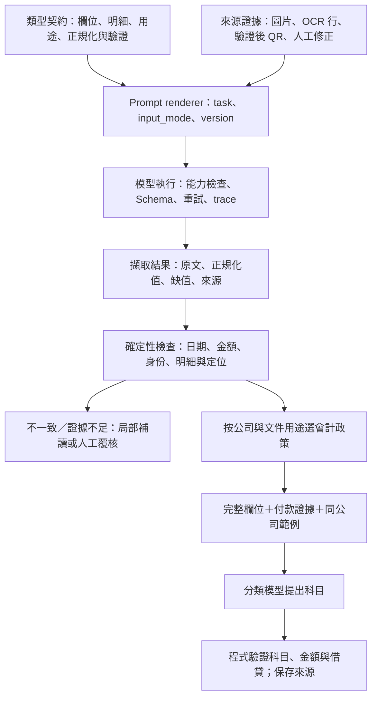

# 提示詞盤點與架構分析

> 核對日期：2026-10-06；範圍：正式 `app/` 程式與獨立驗證流程。
> 下方原盤點與風險清單是提示詞重構前的基準紀錄；本輪實作狀態見第 0 節。舊分析保留供追蹤，不代表現行程式仍有該缺陷。

## 0. 本輪實作與驗證狀態

2026-10-06 已完成三個共用提示模板與 18 類契約重構；全範圍離線驗收 74 項通過。沒有啟動真實模型、讀取私有掃描或 gold，也沒有證據可宣稱辨識準確率提升。真實模型比較仍待使用凍結資料、固定執行條件及相同模型設定完成。

| 項目 | 本輪實作狀態 |
|---|---|
| 共用提示模板 | [prompts.py](../../app/core/prompts.py) 提供 `ROUTE_TEMPLATE`、`EXTRACT_TEMPLATE`、`ACCOUNTING_TEMPLATE` 與對應路由／萃取建構器；一般與進口會計分類共用會計模板 |
| 文件契約 | [doc_types.py](../../app/core/doc_types.py) 保留 18 keys，以 `type_hints` 取代舊 `extra`；`receipt.withholding_tax`、`LineItem.hs_code`、`LineItem.origin_country` 已納入契約 |
| 模型呼叫與正規化 | [model_invocation.py](../../app/core/model_invocation.py) 定義兩個語意輪，每輪最多 3 次傳輸嘗試；[normalization.py](../../app/core/normalization.py) 集中輸出正規化 |
| QR 證據 | [barcode.py](../../app/core/barcode.py) 支援多個 QR 的欄位候選；來源衝突留在 `validation_warnings`，不靜默覆蓋 |
| 分類上下文與證據 | `classify._accounting_context()` 提供完整憑證、金額來源及推導值；模型只收到已選取的現行證據，完整證據歷史仍保存。人工修改後會重算日期、金額、統編等目前警告，同時保留原始來源及衝突診斷。`Voucher` 有 `field_evidence`、`validation_warnings`、`classification_meta`，`JournalEntry` 有 `evidence_paths` |
| 收據稅額語意 | 舊 `receipt` 稅額未區分語意時以 `field_evidence.semantic_role=unconfirmed_tax` 保留；canonical 再次儲存不映射為共同營業稅，人工移至 `withholding_tax` 後解除 |
| 傳票與列印 | `original_checks` 保存完整性、單側狀態、觀察總額及列印總額核對；`balance_check` 僅表示實際借貸相等。原始傳票保留檢查結果並略過新分錄；日記帳列保留 null 金額與證據、忽略舊 `bill_detail` 分錄列。前端／列印附上 escaped 來源、驗證及政策紀錄；重複舊瀏覽器儲存不覆蓋服務端 audit/stale 標記 |
| 公司政策 | 設定檔為 `accounting_policies.json`；角色鍵為 `import_prepayment`、`input_tax`、`fees`、`bank`、`cash`、`payable_goods`、`payable_expense`、`insurance`，各角色值為 `{name, code?}` 物件。付款已付時須有付款方式才選銀行／現金；未付款進口／商品用 `payable_goods`，一般未付費用用 `payable_expense`，未明方向不強制貸方。完整範例見 [會計政策](accounting-policy.md) |
| 候選狀態與範例 | 缺金額／科目或有 warning/assumption 時為 `candidate`；`skipped` 只標佐證附頁或保留原始傳票分錄。範例須同公司、同一當次 hash、`proposed`、已核定且有效平衡；舊未限定公司種子略過 |
| 相容性與批次版本 | 舊保存資料仍可讀，API、前端及 CSV 已追加 metadata；hash v2 含完整來源清單及 runtime digest。舊批次唯讀，新舊版本禁止混續 |

### 比較方式與已產出報告

比較時使用同一份合成 OCR 證據，對齊改版前與現行生成器完整文字輸入，計入核心指令、契約、語意提示及 OCR；不計圖片 bytes、不加公司資料或動態案例。單位是 Unicode 字元，不是模型 token、速度或準確率。報告顯示 image 平均 1641.0→1231.8（-24.9%），OCR text 平均 1544.3→1227.7（-20.5%）；出口報單及進口報單因契約欄位豐富而增加，不能推論所有任務輸入成本下降。完整逐型資料見 [提示長度比較報告](prompt-length-report.md) 與 [JSON 報告](prompt-length-report.json)。

重試上限按語意輪與傳輸輪分開計算：Router 3→6、欄位擷取 9→6、選配補讀 3→6、會計分類 1→6；每任務正常回應仍只呼叫一次。含補讀的欄位擷取最壞上限維持 12 次。真實模型正確率、漏填率、人工修改量、實際重試數及延遲仍待固定資料集比較。

全範圍離線驗收 74 項通過；離線驗收與真實模型比較分開記錄。

### 真實模型比較待辦

- [ ] 使用凍結且可比的輸入、相同模型版本與參數，比較改版前後的欄位抽取與會計候選分錄。
- [ ] 分開報告欄位完整度、值正確率、證據／警告品質及會計分錄科目與金額；標示樣本數與排除原因。
- [ ] 確認 policy hash、範例選取及提示長度報告與實際批次 metadata 一致。
- [ ] 在結果完成前不宣稱準確率提升，也不修改 gold 或將測試資料加入 few-shot。

## 1. 結論與盤點範圍

目前「Router → 類型專屬擷取 → 規則處理 → 人工覆核 → 會計分類」分工可保留；需要調整的是提示詞、資料契約、資料來源與執行策略之間的界線。已有直接可確認的矛盾與欄位遺失，增加提示詞規則或只更換模型無法解決這些問題。

完整原文與生成快照見 [提示詞完整清單](prompt-catalog.md)，系統背景見 [目前系統架構](architecture.md)。盤點包含 Router、18 種正式擷取模板、印章補讀、JSON 修正、兩種會計分類、OCR 純文字驗證變體、動態附加指令與未使用模板。不納入 `archive/`、文件中的部署指令或私有執行期資料。

按實際可生成的模板計算：正式流程 23 份（Router 1、擷取 18、補讀 1、JSON 修正 1、會計分類 2），純文字驗證另有 19 份（Router 1、擷取 18），加上未使用的 `STRUCTURE_PROMPT` 1 份，共 43 份快照。這是對共享模板展開後的計數，不表示有 43 套獨立維護的邏輯，也不含每筆資料帶來的無限種動態組合。

## 2. 提示詞來源與組合

| 提示詞／指令片段 | 來源 | 輸入／輸出 | 評估 |
|---|---|---|---|
| Router | `doc_router.ROUTER_PROMPT` | 圖片、類型選單 → `type`、`rotate` | 單一任務合理，但應將類型與方向狀態、解析失敗分開表達；目前錯誤與真正「其他」混合 |
| 類型擷取 | `doc_types.build_extract_prompt(type_key)` | 完整圖片、共用規則、類型欄位與 `extra` → `fields`、`items`／`entries`、`note`、`confidence`、選配 `boxes` | 共享登錄表值得保留；JSON 範本與實際資料模型須同步 |
| 印章補讀 | `pipeline._read_seal_taxid()` | 完整圖片 → `seller_name`、`seller_tax_id` | 任務小而清楚；對收據使用「統一發票」措辭，回傳欄位又與收據契約不一致 |
| JSON 修正 | `pipeline.extract_for_type()` | 最多前 4,000 字的壞輸出 → 修正 JSON | 缺原圖、原始契約與明確解析錯誤；格式合法不代表內容仍忠於原始辨識 |
| 一般會計分類 | `classify.CLASSIFY_PROMPT` | 憑證摘要、公司科目表、歷史／種子示例 → `entries` | 應與原文擷取分離；固定示例與動態公司科目表可能衝突，付款證據未完整傳入 |
| 進口會計分類 | `importdecl.IMPORT_CLASSIFY_PROMPT` | 進口憑證摘要與科目表 → 專用分錄 | 記帳慣例需按公司／政策版本配置；目前硬編碼科目、金額規則與示例有衝突 |
| 純文字 Router | `validation._text_classify()` | 用字串替換改寫 Router，再附 OCR 文字；`rotate=0` | 應由明確輸入模式生成，而非從圖片提示詞做局部替換 |
| 純文字擷取 | `validation._text_extract()` | 改寫圖片擷取模板、按行刪 boxes 指令、附 OCR 文字 | 類型特殊規則仍可能要求看圖、印章或勾選；按關鍵字刪行也會留下 JSON 尾逗號 |
| 舊通用結構化 | `pipeline.STRUCTURE_PROMPT` | 原圖＋OCR → 舊頂層憑證格式 | 無呼叫，與目前 `fields` 契約不同；移除或明確標為歷史，不作現行修改入口 |

來源：[Router](../../app/core/doc_router.py)、[類型與擷取生成器](../../app/core/doc_types.py)、[補讀／修復／組合](../../app/core/pipeline.py)、[一般分類](../../app/services/classify.py)、[進口分類](../../app/services/importdecl.py)、[純文字驗證](../../app/validation.py)。

動態部分也屬提示詞架構，不能只盤點大寫常數：

| 附加片段 | 內容來源與目前指令 | 建議 |
|---|---|---|
| Router 人工提示 | 審核備註，要求據此判斷類型 | 以有來源的修正資料呈現，標明作用範圍 |
| OCR grounding | OCR 行純文字，指示「數字以圖為準」 | 保留行 ID／座標／分數，區分可見圖片與純文字模式 |
| 原始條碼／QR | 解碼文字，稱「可信度高，可直接採用」 | 區分原始文字與格式驗證後的欄位；解碼成功不等於所有內容都能覆蓋欄位 |
| 電子發票欄位 | 解析後號碼、日期、金額、統編，要求優先採用 | 用程式管理來源優先序，保留與圖像值的衝突證據 |
| 擷取人工提示 | 審核備註，要求「優先修正」 | 明確區分人工指定值、重新核對要求與一般備註 |
| 公司科目表 | `accounts.as_prompt_list(company)`，要求只用列出的代號／名稱 | 模型輸出後再以程式驗證科目成員與名稱，不能只依指令 |
| 歷史已核定分錄 | `bge-m3` top-3 相似範例 | 先限制公司，再保留來源憑證摘要與適用條件；目前只附分錄陣列 |
| 客戶記帳種子 | 共用 `entry_examples.json`，要求比照選科目 | 配置公司、政策版本與適用條件，避免被當作本次數字來源 |
| 憑證摘要 | `_voucher_brief()` 的 JSON | 保留專屬費用、付款狀態、幣別、單據類型與來源頁，避免把必需資訊裁掉 |

目前圖片擷取與會計分類均以單一 `user` 訊息承載規則及資料。可拆為穩定任務規則與明確標記的輸入資料區塊；供應商支援時使用相應訊息角色，並定義人工修正、機器證據、範例與本次資料的優先序。這能減少規則互相覆蓋及模型把示例數字當作本次值的歧義，角色本身不等於資料驗證。

## 3. 十八種類型擷取提示詞逐項分析

所有類型共用繁體、日期、純數字金額、缺值、總額選取及標量欄位規則；下表列各類差異與契約重點。欄位全文與每一份生成提示詞均列於清單附錄。

| 類型代碼 | 特殊任務／規則 | 調整重點 |
|---|---|---|
| `invoice` | 發票格式、課稅別、買賣方、印章統編、中文大寫金額與算術核對 | 客戶名稱／統編為固定先驗，可能引導猜填；空白不可回推與共用加總要求須統一；大寫和數字衝突應保留證據 |
| `cheque` | 大寫金額優先、票號、發票人／受款人，混合頁只讀支票 | 多單據頁應先圈選目標；大寫與數字讀值分開，再判定衝突 |
| `remittance` | 本金、扣款、手續費、付款及收款角色 | 已付款與帳戶資訊需保留給下游，避免 `_voucher_brief()` 丟失 |
| `customs_tax` | 三聯取一聯、各稅費項目、稅基與報單號 | 不跨聯混填合理；稅費分項必須傳入分類，不可只留總額 |
| `export_declaration` | 48 格按編號擷取，貨物欄位只取第一項 | 第一項限制會丟掉其餘貨物；需明確標為摘要或建立完整明細契約；不得走進口分類 |
| `import_declaration` | 進口商／國外賣方、CIF、分項稅費、多項貨物 | 要求 `hs_code`／`origin_country`，但 `LineItem` 不保存；稅費加總應與原印總額分離 |
| `broker_note` | 各費別明細、代墊稅費／勞務費、預收與餘額 | `extra` 要求部分費用為「頂層欄位」，主模板要求在 `fields`；應統一 JSON 路徑及費用性質 |
| `declaration` | 未分進出口時填 `direction` | 未知方向不得用關鍵字強制當進口；需回報待確認類型 |
| `tax_bill` | 多聯稅款繳款書、本稅／滯納金與繳納期間 | 通用「填發日優先」不一定適用期限／期間；明定每個日期的語意 |
| `utility` | 水電／電信、總繳款金額優先，識別碼不得當金額 | 公用事業共用規則過多且含個案數字；按帳單布局與支付證據細分，保留總額原文 |
| `receipt` | 收款人、事由、未必有統編，稅額規則使用扣繳描述 | `tax_amount` 的營業稅與扣繳語意混用，會影響後續稅額分錄；補讀鍵應與 `vendor`／`tax_id` 對齊 |
| `statement` | 對帳單不是發票、發票號只作勾稽、空白數量／單價不補 | 雙方使用 `issuer`／`customer`，共同 `seller`／`buyer` 對映未涵蓋；分類可能漏掉交易方 |
| `purchase_order` | 下單客戶／供應商、明細、付款條件與交期 | 不能只因可擷取總額就直接認定可入帳；下游需有單據用途／入帳資格規則 |
| `fda_import` | 進口商／製造廠、許可號、批號、產地與效期 | 以許可佐證為主；不能靠類型名稱中的「進口」直接推定稅費分錄 |
| `social_insurance` | 逐項費用、不得臆造營業稅或勞雇分攤 | 保留單位／個人是否有實際列示，將判讀與客戶分錄政策分開 |
| `bill_detail` | 費用附頁、識別碼排除、不單獨產分錄 | `extra` 包含「繳費結果通知」，Router 卻排除此類；衝突可能讓可入帳單據被跳過 |
| `journal_voucher` | 按列擷取借貸、單面現支／收入不補隱含一側 | 結尾又要求兩側相等，與前段單面規則矛盾；區分原印合計、計算合計與完整／單面檢查 |
| `other` | 泛用買賣方、金額與明細 | 保留未知／低證據狀態，避免一律套一般發票式欄位與分類 |

密集類型不讓 VLM 產框、改由 OCR 定位的策略可保留；其他五類（`invoice`、`cheque`、`remittance`、`receipt`、`other`）仍要求框。缺少 OCR 時應明確標示定位不可用，欄位讀值與框的品質不能混為一談。

## 4. 已確認的矛盾與資料鏈缺口

### 4.1 JSON 範本不是合法 JSON

`build_extract_prompt()` 將欄位組成 `key（標籤）`，用頓號連接後放進 `"fields": { ... }`。沒有雙引號鍵、冒號和值，無法直接作為合法 JSON 示例。模型同時收到「只回合法 JSON」與不合法模板；目前靠模型自行理解及後續修復補救。

應由契約生成合法示例與 JSON Schema，標籤說明放在 schema 描述或獨立欄位表。不要為了顯示所有欄位而用 0 暗示未知金額；缺值用明確的 null／狀態定義。

### 4.2 抽取、計算與判讀混在一起

共用規則要求「需要相加自行算完」與「以明細加總驗證總額」，發票又禁止用別欄回推；進口要求稅費加總，一般／進口會計分類又要求金額直接取憑證。應分開原始讀值、正規化值、程式計算值和人工修正值，讓原印總額缺失或不一致成為可見狀態。

`journal_voucher.extra` 前段允許單面現支／收入，後段要求 debit／credit 合計相等，直接矛盾。應依 `voucher_kind` 決定檢查方式，維持擷取忠於紙面；會計處理需要補另一側時由後續政策另行產生。

### 4.3 分錄範例與規則不一致

一般分類說未付費用應用「應付費用」，固定例卻以「倉租及理貨費」搭配「應付帳款」，且標題稱「進貨」。應讓案例性質、付款狀態、科目與文字規則一致，或移除硬編碼公司案例，改用符合當次科目表的範例。

進口分類要求貸方為借方加總，同時又禁止自行加總；範例借方 `200028 + 60008 = 260036`，貸方卻為 `260436`，差額 **400**。固定的 1210／1290／6230／1110／2130 也可能與公司科目表「只能用表內代號」相衝突。這些是文字／數值可直接確認的問題，並非模型準確率推測。

### 4.4 要求讀出的內容沒有被保留或傳到下一階段

進口提示詞要求每項貨物的 `hs_code`、`origin_country`，但 Pydantic `LineItem` 只定義 description／quantity／unit_price／amount，額外欄位會被忽略。合成資料核對已確認這兩個鍵未出現在序列化結果。

`_voucher_brief()` 只包含 doc_type、date、買賣方名稱、簡化 items、subtotal、tax_amount、total_amount、note；沒有 `doc_type_key`、專屬 `fields`、付款狀態、幣別、進口 duty／trade_fee／報單號等。因此分類提示詞要求直接引用的資料可能根本沒收到，note 是否碰巧帶到資訊不能當作可靠契約。

收據契約是 `vendor`／`tax_id`，印章補讀觸發卻檢查 `seller_tax_id`，造成原本 tax_id 有值仍可能補讀；回填又新增非契約鍵。對帳單 `issuer`／`customer` 等欄位沒有完整映射到共用 seller／buyer，完整擷取成功也不保證分類摘要保有相同內容。

有些格式差異已有明確轉換，不能當成遺失：傳票的原始 `account_code`／`debit`／`credit` 由 `_entries_from_voucher_form()` 轉成共用 `JournalEntry`；進出口 `direction` 雖未列在專屬 fields 範本，`_build_voucher()` 會按確認類型補入。改造契約時應保留這些可追蹤的轉換，並區分「模型需讀取」與「程式可確定產生」的欄位。

來源：[擷取契約](../../app/core/doc_types.py)、[共用明細模型](../../app/models/schemas.py)、[補讀與共同欄位對映](../../app/core/pipeline.py)、[分類摘要](../../app/services/classify.py)。

### 4.5 路由、修復與範例管理屬架構問題

- `is_import()` 只搜尋 doc_type／note 中的「進口報單」「報單」「進口」，出口報單與附帶提及也會命中。應以已確認的類型與方向決定政策。
- Router 以子字串命中代碼／別名，失敗降級 other；應先嚴格驗證枚舉，未知類型與模型呼叫錯誤分開回報。
- `bill_detail` 擷取說明與 Router 類型定義不一致；分類服務會直接跳過 supporting 類型，因此不只是顯示用詞問題。
- 純文字模式由 `.replace()`／按行刪關鍵字得到，尚有視覺指令；刪除 boxes 行後 confidence 行可留下尾逗號。應由輸入模式生成完整模板。
- JSON 修正僅取得壞輸出前 4,000 字，沒有原始契約與圖片；不要把補成合法 JSON 視為語意修復成功，修復後仍需檢查完整性。
- 歷史範例未按公司篩選，種子檔也沒有在呼叫點按公司選取；檢索只附分錄，欠缺案例與本次資料相似之處的上下文。
- 會計分類直接 `chat.invoke()`，與擷取的重試／trace 包裝器不同；驗證三種模式也沒有覆蓋分錄分類。Prompt 品質評估必須明確區分擷取與會計分類。

來源：[Router 解析](../../app/core/doc_router.py)、[進口判定](../../app/services/importdecl.py)、[分類與檢索](../../app/services/classify.py)、[驗證改寫](../../app/validation.py)、[JSON 修正](../../app/core/pipeline.py)。

## 5. 建議的架構與改善順序

保留 `DOC_TYPES` 作為類型登錄入口，把生成規則擴充成可驗證的契約，再讓圖像／文字模式從同一份契約生成各自適用的提示詞。初期不必拆成外部 Prompt 服務。

| 優先序 | 工作 | 可檢查的完成條件 |
|---|---|---|
| P0：規則與資料完整性 | 修正非法 JSON 範本、傳票單面矛盾、bill_detail 定義、錯誤分錄示例；明確抽取／計算界線 | 所有生成示例可解析；衝突規則有一致政策；數值示例平衡 |
| P0：資料與路由 | 修正進出口政策選擇；保留進口明細與費用；收據補讀鍵對齊；完整傳遞分類資料 | 合成的已知欄位不丟失；出口不命中進口政策；下游收到必要證據 |
| P1：契約生成與執行 | 定義任務與圖像／文字模式、缺值語意、類型 schema；分類也使用共用執行與 trace | 模式不殘留不適用指令；輸出欄位／型別與合法科目有程式檢查 |
| P1：公司政策與範例 | 公司科目／政策／種子版本化；RAG 按公司、類型與條件篩選 | 不引用其他公司的科目與慣例；範例數值不進入本次欄位 |
| P2：證據與失敗處理 | 欄位來源、原印／計算值、修復狀態、局部補讀、多頁整合 | 能指出哪頁哪個證據支持值；不完整結果不因 JSON 合法就視為完成 |

建議的組裝介面可採 `render(task, type_key, input_mode, schema_version, policy_version)`；這只是介面方向，不是已實作 API。共用規則、類型規則、公司政策、來源證據與範例各有明確責任，避免全部堆入單一長字串。

Prompt 版本應保存最終組裝指令的雜湊、模型／參數、契約與公司政策版本；動態證據有自己的來源識別，不能只用檔案雜湊代表一次完整執行。供應商支援 schema 約束時使用結構化輸出；不支援時仍保留同一份本地契約驗證。

## 6. 本次驗證與限制

本次以 `rg`、定向讀碼和 Python 3.12 合成資料核對完成盤點：18 類模板、非法 fields 示例、進口範例差額 400、`LineItem` 丟棄 hs_code／origin_country、收據契約無 seller_tax_id。沒有讀取私有掃描、歷史核定分錄或種子內容，也沒有呼叫真實模型、重評 gold 或修改辨識規則。

因此本文可確認文字／契約／程式流程問題，但不宣稱每個問題在實際資料上造成的錯誤率或改善百分比。後續實作先用合成資料及離線契約測試驗證，再依 [驗證指南](agent-workflow.md) 使用凍結資料與可比條件評估；不得為通過評分修改 gold 或把測試資料納入 few-shot。
